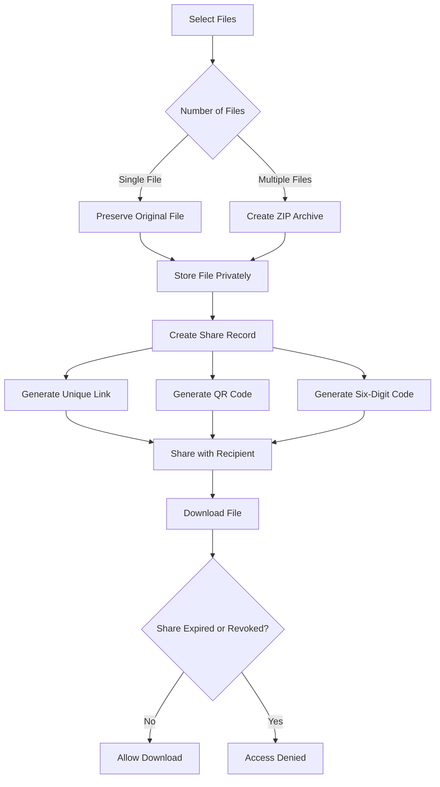

# ShareSpace

### Temporary File Sharing Application

**Share any file. Preserve original quality. Share securely.**

ShareSpace is a full-stack temporary file-sharing web application that allows users to upload files and share them through a unique link, QR code, or six-digit access code. Files remain available for a limited time and are automatically deleted after expiration.

<p align="center">


</p>

---

## Live Demo & GitHub Repository

- **Live Application:** [ShareSpace – Open Application](https://sharespace-nmzj.onrender.com)
- **GitHub Repository:** [View Source Code](https://github.com/YOUR_USERNAME/ShareSpace)

---

## Overview

ShareSpace makes file sharing simple, convenient, and temporary.

Upload a single file to share it in its original format, or upload multiple files and automatically package them into a ZIP archive. Each share provides three convenient access methods, all connected to the same share record and expiration time.

No permanent file-sharing links. No unnecessary complexity. Just simple temporary sharing.

---

## Key Features

| Feature | Description |
|---|---|
| Single File Upload | Share a file in its original format without ZIP conversion |
| Multiple File Upload | Automatically combine multiple files into a single ZIP archive |
| Unique Sharing Link | Generate an unguessable URL for accessing shared files |
| QR Code Sharing | Scan a QR code to open the sharing link |
| Six-Digit Access Code | Share files using a numeric download code |
| Automatic Expiration | Shares expire automatically after 15 minutes by default |
| Automatic Cleanup | Expired files and share records are cleaned up automatically |
| Revoke Sharing | Immediately invalidate an active share |
| Download Tracking | Track download activity |
| Copy & Share | Easily copy sharing links and access codes |
| Drag & Drop | Convenient file selection and upload |
| Responsive Interface | Designed for desktop and mobile devices |

---

## Three Ways to Share

Every uploaded file or ZIP archive receives three access methods.

### 1. Unique Sharing Link

A cryptographically generated, unguessable URL that allows recipients to access the shared file.

### 2. QR Code

A QR code containing the same sharing URL, making access convenient on mobile devices.

### 3. Six-Digit Download Code

A numeric code that recipients can enter to retrieve the shared file.

All three methods point to the same share record and file.

---

## How It Works



### Upload Process

1. The server validates uploaded files and size limits.
2. Single files are stored without ZIP conversion.
3. Multiple files are packaged into a ZIP archive.
4. Files are stored in a private storage directory.
5. A share record is created in SQLite.
6. The server generates a unique token, QR code, and six-digit code.
7. An expiration timestamp is assigned.

### Download Process

1. The recipient opens the unique sharing link or scans the QR code.
2. Alternatively, the recipient enters the six-digit code.
3. The server validates the share and expiration status.
4. The file is delivered through the application backend.
5. Download activity is recorded.

---

## Security & Privacy

ShareSpace includes several baseline security features:

- Cryptographically generated 256-bit URL tokens
- HMAC-SHA256 protected download codes
- Six-digit codes with leading-zero support
- Private local file storage
- Storage paths are never exposed publicly
- Automatic expiration and cleanup
- Share revocation
- Rate limiting on upload and code-validation endpoints
- SQLite persistence with foreign keys and unique constraints
- Basic security headers
- Safe download filenames

> **Security Disclaimer:** This project is a runnable academic project starter and has not undergone a formal security audit. Additional protections are recommended before public production deployment.

---

## Upload & Sharing Limits

| Limit | Default |
|---|---|
| Maximum individual file size | 500 MB |
| Maximum generated ZIP size | 500 MB |
| Default share expiration | 15 minutes |
| URL token | 256-bit cryptographic token |
| Access code | 6-digit numeric code |
| Cleanup frequency | Every 1 minute |

Downloading a file does not extend its expiration time.

---

## Tech Stack

| Technology | Purpose |
|---|---|
| Node.js | Backend runtime |
| Express.js | Web server and REST API |
| SQLite | Database and share metadata |
| HTML5 | Frontend structure |
| CSS3 | Responsive interface and styling |
| JavaScript | Frontend interactions |
| ZIP utilities | Archive generation |
| QR Code library | QR code generation |
| Crypto module | Secure tokens and HMAC codes |

---

## Project Structure

```text
ShareSpace/
│
├── public/
│   ├── app.js
│   ├── download.html
│   ├── download.js
│   ├── index.html
│   ├── result.html
│   ├── result.js
│   └── styles.css
│
├── .env.example
├── .gitignore
├── package.json
├── package-lock.json
├── README.md
└── server.js
```

---

## Getting Started

### Prerequisites

- Node.js version 20 or later
- npm
- Git (optional)

### 1. Clone the Repository

```bash
git clone https://github.com/YOUR_USERNAME/ShareSpace.git
```

### 2. Navigate to the Project

```bash
cd ShareSpace
```

### 3. Install Dependencies

```bash
npm install
```

### 4. Configure Environment Variables

Copy the example environment file.

**Windows PowerShell:**

```powershell
Copy-Item .env.example .env
```

**Git Bash / Linux / macOS:**

```bash
cp .env.example .env
```

Open `.env` and configure your application.

### 5. Generate a Secure Secret

Generate a random secret using Node.js:

```bash
node -e "console.log(require('crypto').randomBytes(48).toString('hex'))"
```

Copy the generated value into the `APP_SECRET` field in your `.env` file.

### 6. Start the Application

```bash
npm start
```

### 7. Open ShareSpace

Visit:

[http://localhost:3000](http://localhost:3000)

### Development Mode

For automatic server restarts during development:

```bash
npm run dev
```

---

## Environment Variables

| Variable | Description | Default |
|---|---|---|
| `PORT` | Server port | `3000` |
| `BASE_URL` | Public URL used in sharing links | `http://localhost:3000` |
| `DATA_DIR` | Private data directory | `./data` |
| `DB_FILE` | SQLite database location | `./data/sharespace.sqlite` |
| `APP_SECRET` | HMAC secret (32+ characters) | Required |
| `MAX_FILE_SIZE_MB` | Maximum size per uploaded file | `500` |
| `MAX_ZIP_SIZE_MB` | Maximum generated ZIP size | `500` |
| `SHARE_TTL_SECONDS` | Share lifetime in seconds | `900` |

---

## API Endpoints

| Method | Endpoint | Description |
|---|---|---|
| `POST` | `/api/upload` | Upload files and create a share |
| `GET` | `/api/share/:token` | Validate sharing link and return metadata |
| `POST` | `/api/download/code` | Validate six-digit access code |
| `GET` | `/api/download/:token` | Download shared file |
| `GET` | `/api/share/:id/status` | Check expiration and download count |
| `POST` | `/api/share/:id/revoke` | Revoke an active share |
| `GET` | `/api/share/:id/qr` | Generate QR code PNG |

---

## Expiration & Revocation

Each share has a single expiration timestamp.

- Shares expire 15 minutes after creation by default.
- Downloading does not extend the expiration.
- Expired shares cannot be accessed.
- Revoking a share invalidates the link, QR code destination, and download code.
- Cleanup runs every minute.
- Expired and revoked database records and stored files are removed by the cleanup process.

---

## Production Considerations

Before deploying ShareSpace publicly, consider:

- HTTPS and a properly configured reverse proxy
- Persistent private storage for uploaded files
- Strong and unique `APP_SECRET`
- Authentication or secure owner-management credentials for revocation
- Robust per-IP and per-code attempt tracking
- Shared rate-limiting storage such as Redis
- Disk quotas and storage monitoring
- Malware scanning
- Backups and log-retention policies
- Upload size limits and proxy timeout configuration
- Streaming or background ZIP generation for large files
- Object storage for high concurrency and large uploads

The current implementation uses local disk storage and SQLite and is intended for a single-server deployment.

---

## Current Limitations

- SQLite and local filesystem storage are used.
- The application is designed for a single-server environment.
- ZIP archives are created on disk before downloading.
- Large uploads may depend on server/proxy limits.
- Automated test suites are not included.
- Database migration tooling is not included.
- Google Fonts requires internet access, although system fonts are available as fallbacks.

---

## Future Improvements

- Cloud object storage integration
- User authentication and personal sharing dashboard
- Password-protected shares
- Advanced abuse protection
- Background ZIP processing
- Storage usage dashboard
- Download analytics
- Automated test suite
- Database migration tooling
- Deployment-ready cloud architecture

---

## Project Information

| Category | Details |
|---|---|
| Project Name | ShareSpace |
| Project Type | Full-Stack Web Application |
| Purpose | Temporary file sharing |
| Backend | Node.js & Express.js |
| Database | SQLite |

---

<p align="center">

**ShareSpace**

Share any file. Anytime. Anywhere.

Made with care.

</p>
